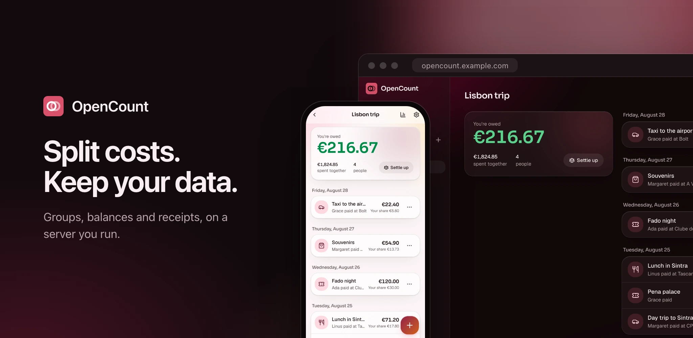

<!-- markdownlint-disable MD041 -->



# OpenCount

Split expenses with friends, see who owes whom, settle up. A self-hosted,
open-source alternative to Tricount that installs on your phone like an app.

[](https://hub.docker.com/r/orochibraru/opencount)
[](https://hub.docker.com/r/orochibraru/opencount)
[](LICENSE)

[See every screen, on a desktop and a phone](docs/showcase.md)

## Features

- **Groups** for a trip, a flat or a dinner, in one of twelve currencies. Add
  people by name before they have an account; they claim their name with
  **That's me**, or pick it when they open the group's invite link.
- **Other currencies**: an expense paid in dollars counts in the group's
  currency at the day's European Central Bank rate, or the one you type, frozen
  on the expense.
- **Expenses** split equally, by shares or by exact amounts, between everyone or
  only some. Amounts are whole cents, so a split always adds up.
- **Balances and settle-up**: everyone's balance, and the fewest payments that
  bring the group back to zero. Record a payment in one tap.
- **Repeating expenses**: rent and subscriptions every week, month or year,
  anchored to their day of the month, with pause and resume.
- **Less typing**: categories guessed from the description in English and French
  and from the group's own categories, merchants remembered per group, custom
  categories per group.
- **Receipt reading**, optional and local: a photo or a PDF fills in the amount,
  the date and the merchant. Read on your server with Tesseract, never stored,
  never sent anywhere.
- **Personal ledger**: a private list of your own expenses that only your
  account sees, each in any currency, with this month's totals by category.
  **Split in a group** adds one to a group, paid by you and split equally,
  converted at the day's rate when the currencies differ. Folders group expenses
  into projects, each with its own totals.
- **Bank sync**, optional: link your bank through Enable Banking (most European
  banks, Revolut included) and booked debits land in your personal ledger every
  day, categorized. Each person sets up their own Enable Banking keys under
  **Account, Bank sync**.
- **Search and filter**: find an expense by description or merchant, or filter a
  group's list by category. Lists load 50 at a time.
- **Insights** by period, category, merchant and payer, and over time.
- **Archiving**: hide a finished group from your own list without touching
  anyone else's.
- **Import and export**: bring a Tricount over from its share link, with its
  expenses, splits, categories and dates, after a preview. Export a group as a
  CSV spreadsheet or a PDF summary (Latin, Greek and Cyrillic names print; CJK
  and emoji print as `?`).
- **Feels native**: an installable PWA with a bottom tab bar, sheets, pull to
  refresh and haptics on phones, a full layout with a sidebar on desktop. Pages
  you already opened reopen offline, and expenses added offline are kept on the
  device and sync once you're back, never twice. Per-account accent colour,
  light, dark or AMOLED theme, font and corners.
- **Invite-only by default**, administered from the app: invites, sign-ups once
  email works, required authenticator apps or passkeys, password and passkey
  sign-in on or off, and single sign-on through any OpenID Connect provider.
  Password reset by email, accounts that change their own email and password or
  delete themselves, and database backups and restores from the admin area.

## Documentation

The full documentation lives in [`docs/`](docs/) and is published at
<https://orochibraru.com/opencount>: install and configuration, every screen,
the admin area, backups and upgrades, troubleshooting.

## Install

OpenCount is one container and one SQLite file. The image,
[`docker.io/orochibraru/opencount`](https://hub.docker.com/r/orochibraru/opencount),
is built for `linux/amd64` and `linux/arm64`.

Download the compose file into an empty directory:

```bash
mkdir opencount && cd opencount
curl -fsSLO https://raw.githubusercontent.com/orochibraru/opencount/main/compose.prod.yaml
```

```yaml
services:
  opencount:
    image: docker.io/orochibraru/opencount:latest
    restart: unless-stopped
    ports:
      - 3000:3000
    volumes:
      - opencount:/data
    environment:
      AUTH_SECRET: ${AUTH_SECRET:?set AUTH_SECRET, e.g. openssl rand -base64 32}
      # The URL people open, like https://opencount.example.com.
      ORIGIN: ${ORIGIN:-}

volumes:
  opencount: {}
```

Write a `.env` next to it with a fresh secret and your public URL, then start
it:

```bash
cat > .env <<EOF
AUTH_SECRET=$(openssl rand -base64 32)
ORIGIN=https://opencount.example.com
EOF
docker compose -f compose.prod.yaml up -d
```

Keep `AUTH_SECRET` with your backups: it signs sessions and encrypts the secrets
stored in the database. Changing it signs everyone out and loses them.

### Configuration

| Variable        | Default                  | What it does                                                      |
| --------------- | ------------------------ | ----------------------------------------------------------------- |
| `AUTH_SECRET`   | none, required           | Signs sessions and encrypts stored secrets; 32 characters or more |
| `ORIGIN`        | from the proxy headers   | The public URL; required on plain HTTP with no proxy              |
| `DATABASE_PATH` | `/data/opencount.sqlite` | The SQLite file, on the `/data` volume                            |
| `PORT`          | `3000`                   | The HTTP port                                                     |
| `LOG_LEVEL`     | `info`                   | `trace`, `debug`, `info`, `warn` or `error`                       |
| `LOG_FORMAT`    | `console`                | `json` or `console`                                               |

Put it behind an HTTPS reverse proxy that sets `X-Forwarded-Proto` and
`X-Forwarded-Host`: passkeys and installing the app both need HTTPS. On plain
HTTP with no proxy, `ORIGIN` must be the exact URL you open (like
`http://192.168.1.10:3000`), or every form is refused as cross-site.

Every other variable, from the background worker to traces and error reporting,
is in [Configuration](docs/configuration.md). Sign-ups, sign-in methods, email
and receipt reading are set in the app's admin area.

### First run

A fresh instance has no account, and every page sends you to the setup screen.
It asks for a code only the server's log shows, so nobody who stumbles on the
URL can claim the instance:

```bash
docker compose -f compose.prod.yaml logs opencount
```

Look for the line starting with `Setup code`: six digits, valid 15 minutes.
Enter it, then your email, name and password. That first account is the admin.
From the admin area, set up email, secure your account with an authenticator app
or a passkey, and invite people.

On a phone, use **Add to Home Screen** to install it.

Step by step, with what each screen does: [First run](docs/first-run.md).

### Upgrades and backups

```bash
docker compose -f compose.prod.yaml pull
docker compose -f compose.prod.yaml up -d
```

Migrations run at boot. Your data is the `opencount` volume: back it up, with
`AUTH_SECRET`, or download a backup from the admin area's Backup tab. See
[Backups and upgrades](docs/backups-and-upgrades.md).

## Contributing

See [CONTRIBUTING.md](CONTRIBUTING.md).

## License

[MIT](LICENSE)
