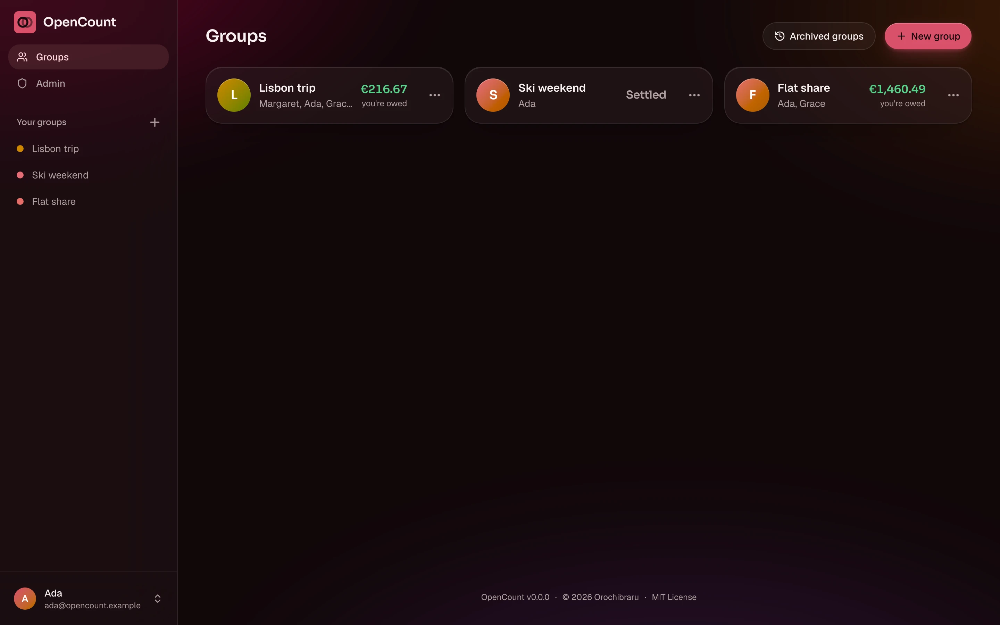
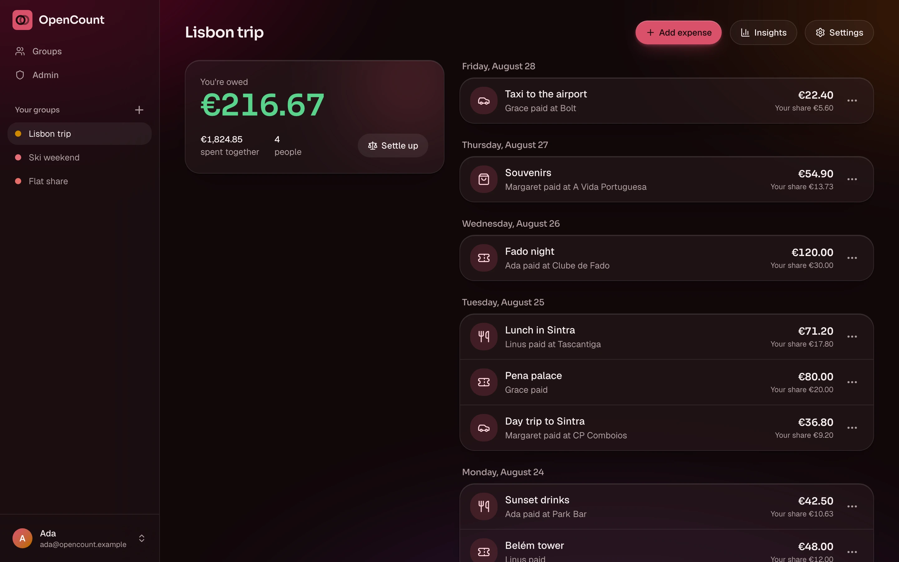
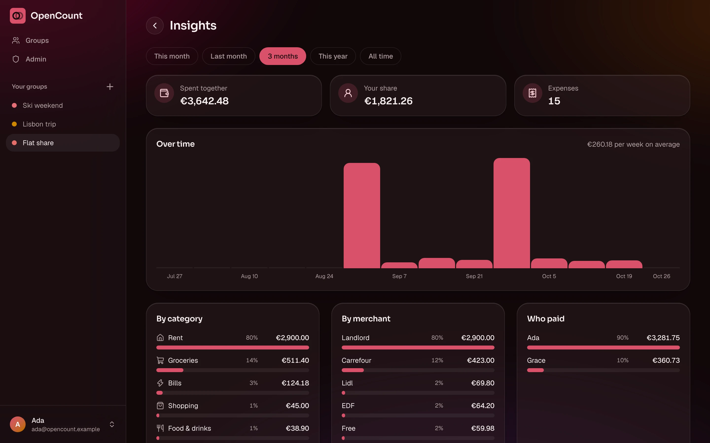
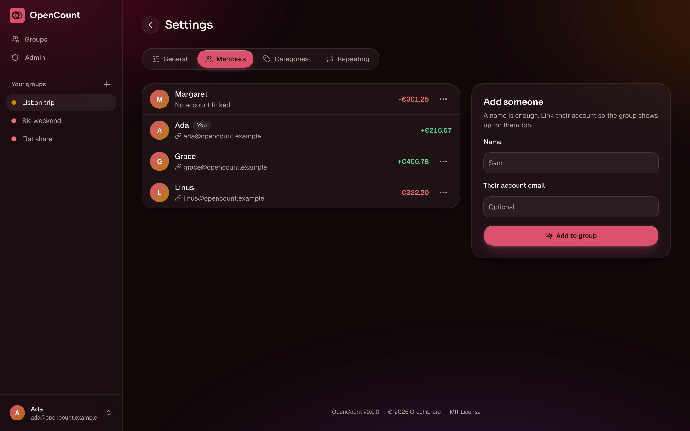
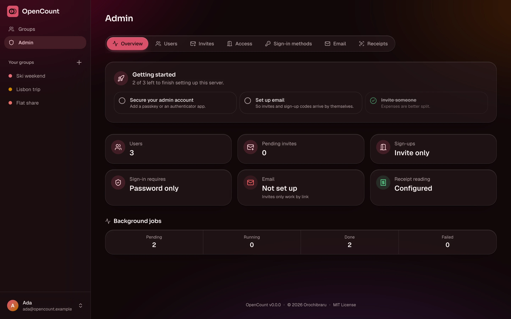
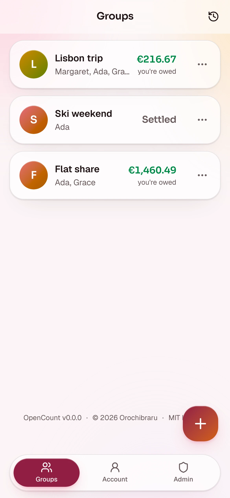
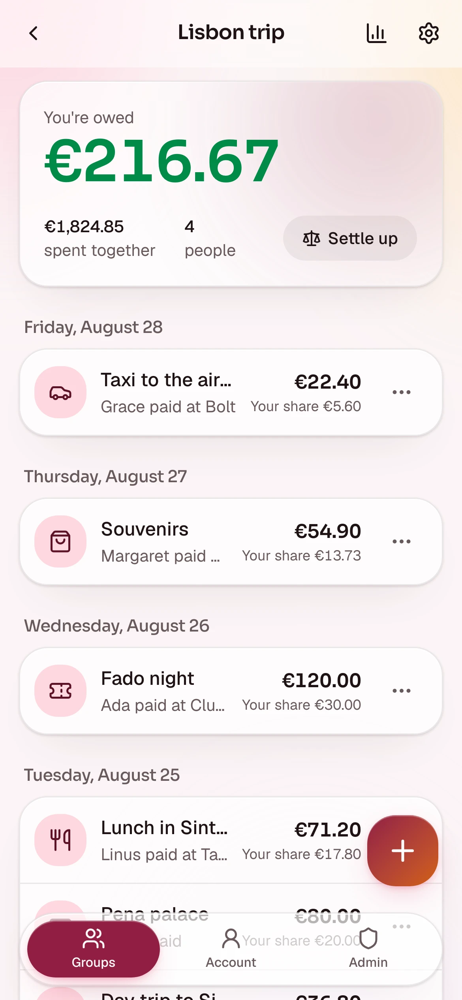
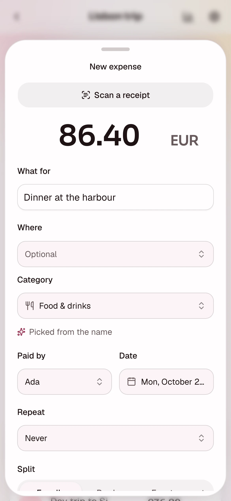
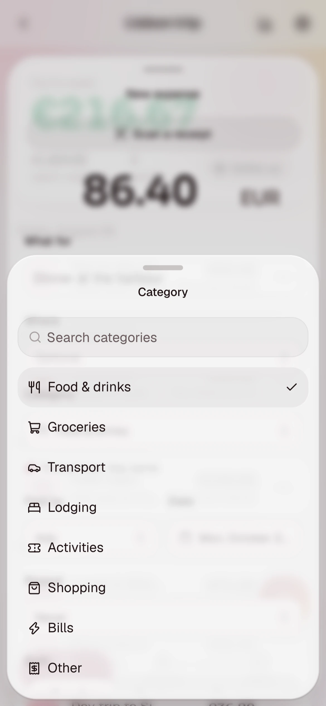
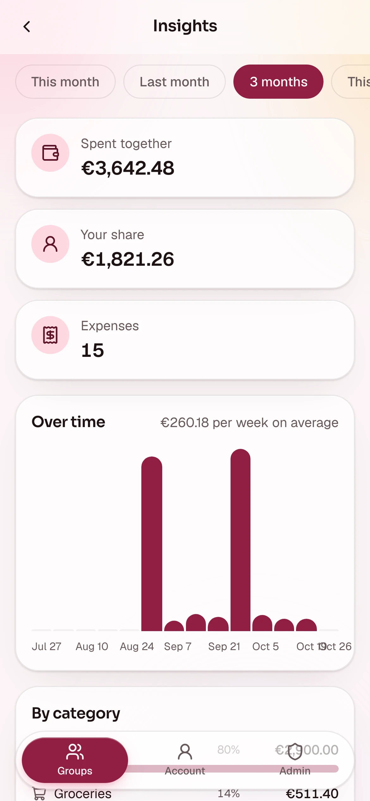

# Showcase

A tour of OpenCount, one screen at a time. Desktop screens are shown in the dark
theme at 1440 by 900, phone screens in the light theme at 390 by 844. Every
name, group and amount is made up.

## On a desktop

The groups list shows each group you are in, who is in it, and your balance in
it at a glance: what you are owed, or what you owe.

A group opens on its expenses, newest first, with your balance on top and a
shortcut to settle up. Add, edit or delete an expense in place.

Insights break the spending down by period, category, merchant and payer, with a
chart of how it moved over time.

A group's settings hold its name and currency, its members, its own categories
its repeating expenses, and importing and exporting. Members added by name show
**No account linked** until someone claims them.

The admin area holds the setup checklist, the users, invites, access rules,
sign-in methods, email, receipt reading, bank sync and backups. Only admins see
it.

## On a phone

On a phone it behaves like an app: a bottom tab bar, a floating button to add an
expense, and a long press on an item for its actions.

Adding an expense happens in a sheet that slides up from the bottom. The
category and merchant pickers are searchable, and the category is guessed as you
type.

## Regenerating the screenshots

`mise run screenshots` retakes every screen into `docs/images/`, and
`mise run showcase` lays out `feature.webp`, the hero at the top of the README.
See [Development](development).
